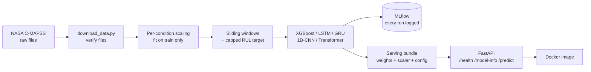

# cmapss-rul: remaining useful life of turbofan engines

Predicts how many operating cycles an engine has left before failure from its sensor history, using NASA's C-MAPSS turbofan data. Compares an XGBoost baseline against four neural architectures (LSTM, GRU, 1D-CNN, small Transformer) in PyTorch, tracks every run in MLflow, and serves the best model through a FastAPI service in Docker.

Predictive maintenance is a common machine-learning use case in energy and aviation: knowing an engine is close to failure lets you schedule repair instead of reacting to a breakdown.

## Problem

Each engine runs until it fails. For every cycle we have 3 operating settings and 21 sensor readings. The task is to predict remaining useful life (RUL), the number of cycles left, from the most recent window of readings.

Two subsets are reported:

| Subset | Operating conditions | Fault modes |
|---|---|---|
| FD001 | 1 | 1 |
| FD004 | 6 | 2 |

FD004 is the harder one: sensor readings mean different things in each operating condition, so they are scaled per condition (see below). FD002 and FD003 are supported by the pipeline but not reported here.

## Architecture



## Method

- **Windows and target.** Sliding windows of 30 cycles (70 for the tuned GRU), one cycle at a time. Each window's target is the RUL at its last cycle, capped at 125 (early in life the sensors barely change, so larger values cannot be told apart).
- **Per-condition scaling.** Each cycle is assigned to an operating-condition cluster (KMeans, 6 clusters for FD004, 1 for FD001) and each sensor is scaled within its cluster. The clusters and the scaling statistics are fit on training engines only and reused for validation and test. Sensors with zero variance after scaling are dropped.
- **Evaluation protocol** (full text in [`docs/evaluation_protocol.md`](docs/evaluation_protocol.md)): validation is a held-out set of whole engines, never random windows; all tuning uses validation only; the official test set is scored once per final model, using the last window of each test engine against NASA's true-RUL file; neural nets use 3 seeds. Short test engines are padded at the start by repeating their first reading.
- **Metrics.** RMSE and the NASA asymmetric score (late predictions are penalised more than early ones). Lower is better for both.

## Results

Official test set, last window per engine, mean ± standard deviation over 3 seeds. Generated from MLflow by `scripts/make_results_table.py` (see [`docs/results.md`](docs/results.md)).

**FD001**

| Model | Window | Test RMSE | Test NASA score |
|---|---|---|---|
| GRU | 30 | 15.28 ± 0.13 | 412 ± 35 |
| Transformer | 30 | 15.34 ± 0.24 | 443 ± 94 |
| XGBoost | 30 | 16.22 ± 0.35 | 403 ± 19 |
| LSTM | 30 | 16.41 ± 1.13 | 575 ± 190 |
| 1D-CNN | 30 | 18.48 ± 0.72 | 766 ± 189 |

**FD004**

| Model | Window | Test RMSE | Test NASA score |
|---|---|---|---|
| GRU (tuned window) | 70 | 25.94 ± 0.29 | 4,310 ± 278 |
| Transformer | 30 | 26.61 ± 0.37 | 4,897 ± 195 |
| GRU | 30 | 26.88 ± 0.21 | 4,962 ± 204 |
| LSTM | 30 | 27.14 ± 0.29 | 5,364 ± 544 |
| XGBoost | 30 | 29.59 ± 0.08 | 7,322 ± 255 |
| 1D-CNN | 30 | 31.47 ± 0.55 | 13,766 ± 2,036 |

**Window-length ablation** (GRU, FD004, validation, 3 seeds, all windows scored on the same 7,565 validation windows so the settings are comparable). The window of 70 was chosen on validation and then confirmed on the test set (table above).

| Window | Validation RMSE |
|---|---|
| 20 | 18.84 ± 0.08 |
| 30 | 16.23 ± 0.31 |
| 50 | 14.06 ± 0.11 |
| 70 | 13.47 ± 0.29 |
| 100 | 13.39 ± 0.37 |

### Compared with published work

Only one published result matched the setup closely enough to list (RUL cap 125, window 30, 80/20 split by engine, one prediction per test engine): a single-author arXiv preprint, [Sharma 2025](https://arxiv.org/abs/2511.19124), Table I. It reports RMSE only, and it does not say how many runs its "average" and "best" figures cover.

| Subset | Published RMSE (average / best) | This project (GRU, 3-seed mean) |
|---|---|---|
| FD001 | 17.25 / 16.22 | 15.28 |
| FD004 | 21.91 / 19.98 | 25.94 (window 70), 26.88 (window 30) |

On FD004 this project is clearly worse than that preprint, and I have not diagnosed why. Other papers use a different RUL cap or window, or do not state how the test set is scored, so they are listed as not directly comparable in [`docs/literature_comparison.md`](docs/literature_comparison.md).

### Where the deep models did not win

- On FD001, the LSTM did not beat XGBoost on the test set (16.41 vs 16.22 RMSE), although it did on validation. LSTM seed 0 had the best validation score but the worst test score.
- The 1D-CNN was the weakest model everywhere and was worse than XGBoost on FD004. An untested guess: its global average pooling weights all cycles equally.
- On FD004, XGBoost is about 2.5 to 3.7 RMSE worse than the LSTM, GRU and Transformer models, which is well outside the seed-to-seed spread.

## Run it

```bash
make setup                 # virtualenv and dependencies
source .venv/bin/activate
make data                  # download and verify the NASA files into data/raw/
make test                  # unit and API tests
```

Train one model (logged to MLflow, stored in `mlflow.db`), then view the runs:

```bash
python -m src.train --subset FD004 --model gru --window 70 --seed 0 --save-dir artifacts/fd004_gru
mlflow ui                  # http://127.0.0.1:5000
```

Every row in the results tables is one `python -m src.train --subset <FD001|FD004> --model <xgboost|lstm|gru|cnn|transformer> --seed <0|1|2> --final` run (plus `--window 70 --val-min-cycle 100` for the tuned GRU). `make reproduce` runs all of them (3 seeds, both subsets, plus the tuned GRU) into a fresh MLflow store under `reproduce/` and writes `reproduce/results.md`; it takes a few hours on a laptop CPU. `make reproduce-fast` is a reduced run (FD001, one seed, tiny models, a few minutes) used by CI. Results can differ slightly from the tables above on other machines.

Regenerate the results table from MLflow: `python scripts/make_results_table.py`.

### Serve the model

```bash
make serve                 # http://127.0.0.1:8000/docs
# or
make docker-build
make docker-run            # http://127.0.0.1:8000/docs
```

Endpoints: `GET /health`, `GET /model-info` (lists the 24 input columns), and `POST /predict` with `{"cycles": [[...24 numbers...], ...]}`, one engine's recent cycles, oldest first (3 operating settings then sensors `s_1` to `s_21`). It returns the predicted RUL, how many cycles were used, whether the history was padded, and the engine's operating condition. The model served is the GRU trained on FD004 with window 70 (`artifacts/fd004_gru`, 176 KB). It runs locally and in Docker; it is not hosted anywhere.

CI (GitHub Actions) runs the tests, builds the Docker image, starts the container, and requests a prediction on every push.

## Limitations

- One fixed 80/20 validation split (20 engines for FD001, about 50 for FD004), so validation numbers carry some split noise. Validation also favours the neural nets slightly, because they keep their best epoch chosen on validation while XGBoost uses a fixed 300 trees.
- Validation scores every window of held-out engines; the test set scores only each engine's last window. The two are not comparable, so compare models within one, not across.
- FD004 test RMSE (about 26 to 31) is much higher than its validation RMSE (about 14 to 21); the reason has not been diagnosed.
- Padded windows for short test engines are an approximation: 11 of 248 FD004 test engines have fewer than 30 cycles, 36 have fewer than 70.
- XGBoost results can differ slightly between machines (the same FD004 seed gave a different validation RMSE on two machines).
- Results come from the laptop CPU; GRU with window 70 was tuned on FD004 only and not re-tuned for FD001.
- The test-time sensor streams in C-MAPSS are simulated run-to-failure data, not field data.

## Repository layout

```
src/data/       loading, per-condition scaling, windowing, pipeline
src/models/     LSTM, GRU, 1D-CNN, Transformer (XGBoost lives in train.py)
src/train.py    trains one model and logs the run to MLflow
src/evaluate.py RMSE, NASA score, last-window test scoring
src/api/        FastAPI service
artifacts/      serving bundle (weights, scaler, config)
scripts/        data download, results table
docs/           evaluation protocol, results, literature comparison
tests/          pytest suite
```

Data: NASA Prognostics Data Repository, Turbofan Engine Degradation Simulation (C-MAPSS), [data set #6](https://www.nasa.gov/content/prognostics-center-of-excellence-data-set-repository).
